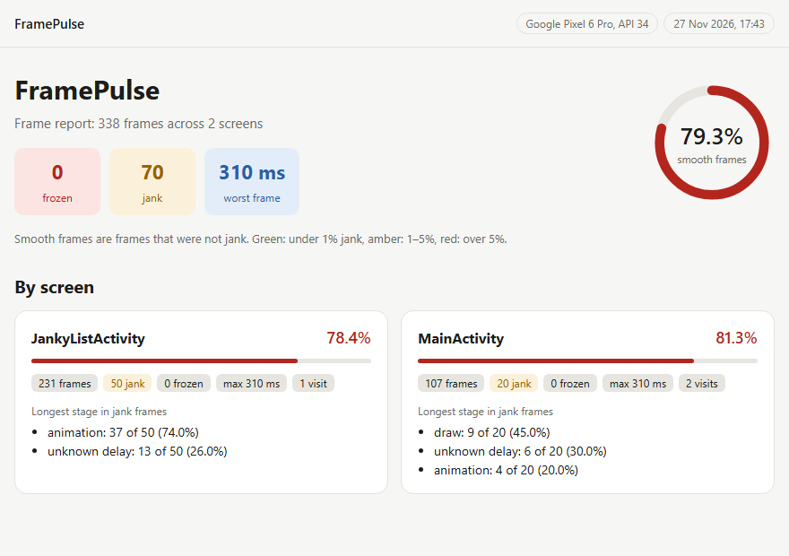

# FramePulse

A Kotlin Android library that measures frame times and jank: rolling-window FPS, percentiles, frozen frames, per-frame jank details with stage breakdowns, tags and session summaries, plus an HTML report of every screen.

**You can add this library to your app to see when and where it janks: on which screen, during which action, and in which stage of the frame.**

<picture>
  <source media="(prefers-color-scheme: dark)" srcset="docs/images/frame-report-dark.png">
  
</picture>

<sub>The report of the demo app on a Pixel 6 Pro, from `./gradlew :app:framepulseReport`. The demo janks on purpose.</sub>

Most Android performance libraries hand you an FPS number and hide how it was produced. I built FramePulse the other way: every piece (frame source, rolling-window math, jank rule, session lifecycle) is written from scratch, tested, and explained.

> Status: alpha. The API may change before 1.0.

## Major Features of the library

- **Drawn frames**: frame times from the platform's frame metrics (API 24+), with a `Choreographer` fallback.
- **Metrics**: rolling-window FPS, average, max and p50 / p90 / p95 / p99 frame times.
- **Jank**: judged against the system's frame deadline (API 31+) or a frame budget that follows the display's refresh rate.
- **Frozen frames**: frames over 700 ms.
- **Jank frames**: a callback for each jank frame, with a stage breakdown (input, animation, layout, draw, sync, GPU).
- **Tags**: say what the app was doing (the screen, "scrolling") during each jank frame.
- **Session summary**: totals, jank rate, whole-session percentiles and a per-tag breakdown.
- **Every activity**: `FramePulse.monitorActivities` measures each activity from `onStart` to `onStop` with one call.
- **HTML report**: apply the Gradle plugin and run `./gradlew :app:framepulseReport` to see a report of every screen on localhost, with no code.
- **Low overhead**: about 65 ns and no allocations per frame on a Pixel 6 Pro.
- **Stable API**: usable from Kotlin and Java, and checked against a recorded API file in CI.

### How to add FramePulse to your project?

FramePulse is on Maven Central. Make sure `mavenCentral()` is in your repositories, then add:

```kotlin
// app/build.gradle.kts
dependencies {
    implementation("io.github.imayankkumar:framepulse:0.2.0")
}
```

- Min SDK 21, no Compose dependency.

### How to get an HTML report of every screen?

Apply the FramePulse Gradle plugin to your app module. There is no code to write, and you do not need the dependency above: the plugin adds `framepulse-report` to your debug builds only, which measures every activity and rewrites an HTML report on the device each time an activity stops.

```kotlin
// app/build.gradle.kts
plugins {
    id("io.github.imayankkumar.framepulse") version "0.2.0"
}
```

Use the debug build, leave a screen, then:

```bash
# Copy the report from every connected device into app/build/reports/framepulse
# and serve it on http://localhost:8765
./gradlew :app:framepulseReport

# Only copy it, for example on CI
./gradlew :app:framepulseReport --no-serve
```

- Each device gets a folder named after its model. With one device, `http://localhost:8765` opens its report; with more, it lists them. Ctrl+C stops the server.
- `--variant` picks another variant (default `debug`), for example one with an `applicationIdSuffix`.
- `framepulse { port = 9000 }` changes the port; the next free one is used if it is taken. `addReportDependency = false` stops the plugin adding `framepulse-report`.
- Without the plugin, add `debugImplementation("io.github.imayankkumar:framepulse-report:0.2.0")` and copy the file with `adb pull /sdcard/Android/data/your.package.name/files/framepulse-report.html`. Keep it out of release builds: it measures every activity and writes a file on the device.
- The report shows the share of smooth frames, the jank and frozen frames, the worst frame, and one card per screen with the frame stage that was longest in its jank frames and the tags set when they happened.
- Every number is a count FramePulse measured, added up over every visit since the app started. There is no weighted score, and percentiles are left out because they cannot be added up across visits.
- The exact path is logged once: `adb logcat -s FramePulse`. `FramePulseReport.reportFile(context)` returns it too.
- The report's sessions are separate from yours, so tags you set on your own sessions do not show in it. Set them with `FramePulseReport.sessionFor(activity)?.setTag(...)`.

### How to start a session?

Start a session when your UI becomes visible and stop it when it isn't:

```kotlin
class MainActivity : ComponentActivity() {

    private var session: FramePulseSession? = null

    override fun onStart() {
        super.onStart()
        // Measures the frames this activity's window draws (API 24+).
        session = FramePulse.start(this, FramePulseConfig.DEFAULT) { metrics ->
            Log.d("FramePulse", "fps=%.1f jank=%d max=%.1fms".format(
                metrics.fps, metrics.jankCount, metrics.maxFrameTimeMs))
        }
    }

    override fun onStop() {
        session?.stop()
        session = null
        super.onStop()
    }
}
```

- `FramePulseMetrics` covers the last `windowDurationMs`: `fps`, `frameCount`, `averageFrameTimeMs`, `maxFrameTimeMs`, `p50FrameTimeMs` … `p99FrameTimeMs`, `jankCount`, `frozenFrameCount`, and since the start `totalFrameCount`, `totalJankCount`, `totalFrozenFrameCount`.
- From Java, `start` is static: `FramePulse.start(this, metrics -> Log.d("FramePulse", "fps=" + metrics.getFps()));`

#### How to change the defaults?

```kotlin
val config = FramePulseConfig.Builder()
    .windowDurationMs(2_000)
    .reportIntervalMs(500)
    .build()
```

| Option | Default | Meaning |
|--------|---------|---------|
| `windowDurationMs` | 1000 | Rolling window length |
| `expectedFramePeriodMs` | 16.67 | Frame budget, or `refreshRate(hz)`. Follows the display when you pass an `Activity` or a `Display` |
| `jankThresholdMultiplier` | 1.5 | Jank if frame time > budget × multiplier. Not used for drawn frames on API 31+ |
| `reportIntervalMs` | 250 | Minimum time between listener calls; 0 = every frame |

### How to see each jank frame?

Pass a `jankFrameListener`. It is called on the main thread, before the metrics listener for the same frame:

```kotlin
session = FramePulse.start(
    activity = this,
    jankFrameListener = { frame ->
        Log.w("FramePulse", "jank: %.1f ms (budget %.1f ms), stages=%s".format(
            frame.durationMs, frame.budgetMs, frame.stages))
    },
) { metrics -> /* rolling-window metrics as before */ }
```

- A `JankFrame` has `durationMs`, `budgetMs`, `isFrozen`, `frameTimeNanos`, the `tags` set while it ran, and `stages` for drawn frames (`null` for `Choreographer` frames).
- `FrameStages` holds the platform's stage durations: `unknownDelayMs`, `inputHandlingMs`, `animationMs`, `layoutMeasureMs`, `drawMs`, `syncMs`, `commandIssueMs`, `swapBuffersMs` and `gpuMs` (API 31+). They partly overlap, so they do not add up to `durationMs`.

### How to tag what the app was doing?

Set tags on the session from the main thread. A tag belongs to every frame that ran while it was set:

```kotlin
session?.setTag("screen", "Feed")

recyclerView.addOnScrollListener(object : RecyclerView.OnScrollListener() {
    override fun onScrollStateChanged(recyclerView: RecyclerView, newState: Int) {
        if (newState == RecyclerView.SCROLL_STATE_IDLE) {
            session?.removeTag("scrolling")
        } else {
            session?.setTag("scrolling", "true")
        }
    }
})
```

### How to get a session summary?

`session.summary()` returns the totals for the whole session, while it runs and after `stop()`:

```kotlin
override fun onStop() {
    session?.let { s ->
        s.stop()
        val summary = s.summary()
        Log.i("FramePulse", "%d frames, %.1f%% jank, p95 %.1f ms".format(
            summary.frameCount, summary.jankRate * 100, summary.p95FrameTimeMs))
        summary.tags.forEach { tag ->
            val jank = "%.1f".format(tag.jankRate * 100)
            Log.i("FramePulse", "${tag.name}=${tag.value}: $jank% jank")
        }
    }
    session = null
    super.onStop()
}
```

- `SessionSummary` has `durationMs`, `frameCount`, `jankCount`, `frozenFrameCount`, `jankRate`, `p50FrameTimeMs` … `p99FrameTimeMs`, `maxFrameTimeMs` and one `TagSummary` per tag value.
- Memory stays constant however long the session runs: the session percentiles come from a fixed histogram (0.1 ms steps up to 50 ms, 1 ms steps up to 1 s). Up to 256 tag values are counted per session.

### How to measure every activity?

Call `FramePulse.monitorActivities` once in your `Application`. Each activity's summary is passed to your listener when it stops:

```kotlin
class MyApp : Application() {

    override fun onCreate() {
        super.onCreate()
        FramePulse.monitorActivities(this) { activity, summary ->
            Log.d("FramePulse", "%s: %d frames, %.1f%% jank".format(
                activity.javaClass.simpleName, summary.frameCount, summary.jankRate * 100))
        }
    }
}
```

- Each session is tagged `activity` = the activity's class name (`FramePulse.ACTIVITY_TAG`).
- `monitor.sessionFor(activity)` returns an activity's running session, for example to set more tags.

### Threading and lifecycle

- Call `start()`, `setTag()`, `removeTag()` and `summary()` on the main thread. `stop()` works on any thread.
- The listeners run on the main thread, so keep them cheap. `FramePulseMetrics` is immutable.
- Stop a session when you no longer need it, normally in `onStop`. A session started with an `Activity` also stops itself when the activity is destroyed. A stopped session cannot be restarted.

### Known limitations

- **A pause counts as one long frame** with `Choreographer` callbacks (for example the screen turning off). Stop the session in `onStop`, or use `monitorActivities`.
- **A fixed budget misjudges variable refresh rates.** `start(config, listener)` keeps one budget; use the `Activity` or `Display` overload, which follows `Display.getRefreshRate()`.
- **Observer effect.** The listener runs on the main thread, so whatever it does (for example updating UI) is measured too.
- **No code attribution.** The stage breakdown says which stage was slow, not which code. Use Perfetto or Android Studio's profiler for that.
- Only the activity's own window is measured (not dialogs), and it must be hardware accelerated (the default).

### Overhead

FramePulse's own work per frame, measured with [Jetpack Microbenchmark](https://developer.android.com/topic/performance/benchmarking/microbenchmark-overview) on a Pixel 6 Pro (Android 14, release build), at 120 Hz with the default config:

| Per frame | Median time | Allocations |
|-----------|-------------|-------------|
| Drawn frame through the session | 65 ns | none¹ |
| Same, with 3 tags set | 83 ns | none¹ |
| `Choreographer` tick through the session | 66 ns | none¹ |
| Jank frame with a `jankFrameListener` | 308 ns | 6 (the `JankFrame`, its stages and tags) |

¹ Apart from one `FramePulseMetrics` snapshot per report interval, which the times include.

### How to run the demo app?

`:app` is a test bench with screens that jank on purpose: a dashboard with live metrics and buttons that block the main thread, and a janky list measured by `monitorActivities`.

```bash
# Install the demo app on a connected device
./gradlew :app:installDebug

# Watch the summaries it logs
adb logcat -s FramePulse

# Copy the HTML report of every screen you used and open it on http://localhost:8765
./gradlew :app:framepulseReport
```

### Example Output

Scrolling the janky list at 8 ms per row on a Pixel 6 Pro, then going back:

```
JankyListActivity stopped: 709 frames in 16.5 s, 40 jank (5.6%), 0 frozen
p50 / p95 / p99 / max: 6.5 / 20.2 / 45.8 / 169.6 ms
activity=JankyListActivity: 709 frames, 40 jank (5.6%)
work=2 ms per row: 3 frames, 1 jank (33.3%)
work=8 ms per row: 708 frames, 40 jank (5.6%)
scrolling=true: 613 frames, 38 jank (6.2%)
```

On the same device, FramePulse counted 401 frames and 58 jank frames for a scroll where `adb shell dumpsys gfxinfo` reported 404 frames and 58 janky frames.

### How does FramePulse measure frames?

Each frame passes through five layers, from the public API down to the frame source:

- FramePulse (public API)
- Session
- FrameMonitor
- Calculator
- FrameSource

```
App
 │  FramePulse.start(activity, config, listener)
 ▼
FramePulseSessionImpl ──────────────► FramePulseListener.onMetrics(FramePulseMetrics)
 │                                          ▲
 ▼                                          │
FrameMonitorImpl (IDLE → STARTED → STOPPED) │
 │  frames                                  │
 ├──────────────► RollingWindowFpsCalculator┘
 ▼
FrameSource, one of:
 ├─ FrameMetricsFrameSource ──► Window.addOnFrameMetricsAvailableListener (API 24+)
 └─ ChoreographerFrameSource ──► Choreographer.postFrameCallback (re-posted every frame)
```

#### Drawn frames (API 24+)

```
Window draws a frame ──► platform FrameMetrics (TOTAL_DURATION, DEADLINE)
                                                │
                              rolling window ──► FPS, jank, max frame time
```

> `FramePulse.start(activity, …)` on Android 7.0+. Frame time is the platform's `TOTAL_DURATION`, including work off the main thread. Only drawn frames count, so idle time is never jank. When the window stops drawing, the listener gets one more call with the last frames, then none until it draws again.

#### Choreographer callbacks

```
VSYNC ──► Choreographer (main thread) ──► FrameCallback.doFrame(frameTimeNanos)
                                                │
                                   interval = frameTimeNanos − previous
                                                │
                              rolling window ──► FPS, jank, max interval
```

> `FramePulse.start(config, …)`, `FramePulse.start(context, display, …)`, and `start(activity, …)` on Android 5.0–6.0. It measures how regularly the main thread serviced vsync, not what was rendered: callbacks keep arriving at the refresh rate even when nothing on screen changes.

Learn about the library design in detail from the documents mentioned below:

- [Overall library architecture](docs/ARCHITECTURE.md)
- [FrameMonitor lifecycle](docs/FRAME_MONITOR.md)
- [Looper, Handler and MessageQueue](docs/AndroidInternals-Looper.md)
- What changed in each version: [CHANGELOG.md](CHANGELOG.md)

### TODO

- Compose integration.
- Improvement based on feedback.

## If this project helps you in anyway, show your love ❤️ by putting a ⭐ on this project ✌️

### License

```
   Copyright (C) 2026 Mayank Kumar

   Licensed under the Apache License, Version 2.0 (the "License");
   you may not use this file except in compliance with the License.
   You may obtain a copy of the License at

       http://www.apache.org/licenses/LICENSE-2.0

   Unless required by applicable law or agreed to in writing, software
   distributed under the License is distributed on an "AS IS" BASIS,
   WITHOUT WARRANTIES OR CONDITIONS OF ANY KIND, either express or implied.
   See the License for the specific language governing permissions and
   limitations under the License.
```

### Contributing to FramePulse

All pull requests are welcome. See [CONTRIBUTING.md](CONTRIBUTING.md) for building, testing, benchmarks, releases and the project structure, and [SECURITY.md](SECURITY.md) to report a security problem privately.
