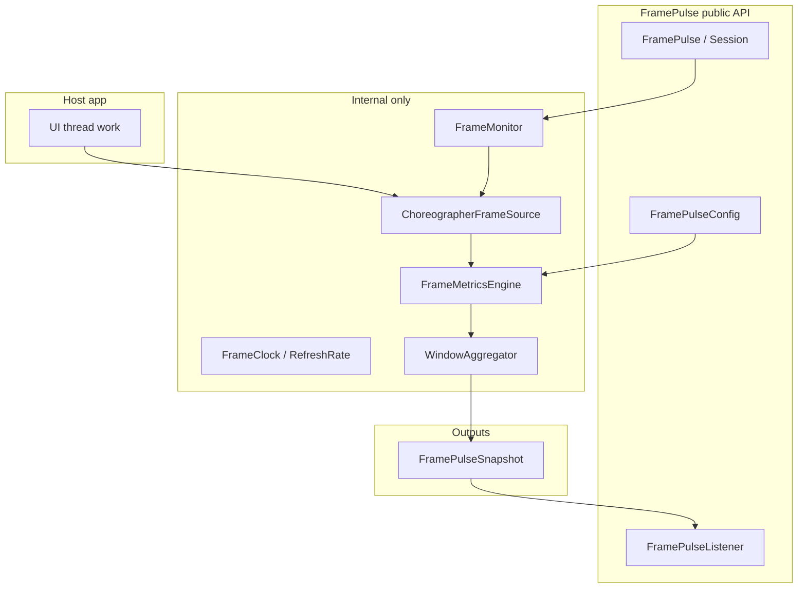
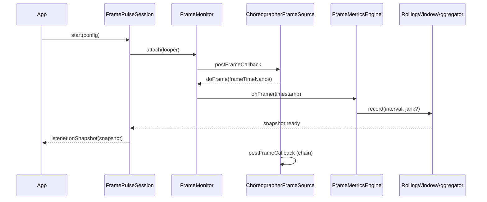
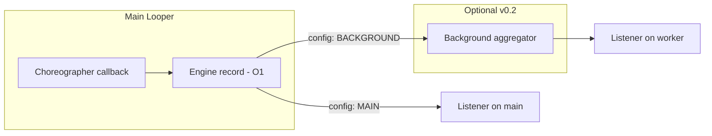
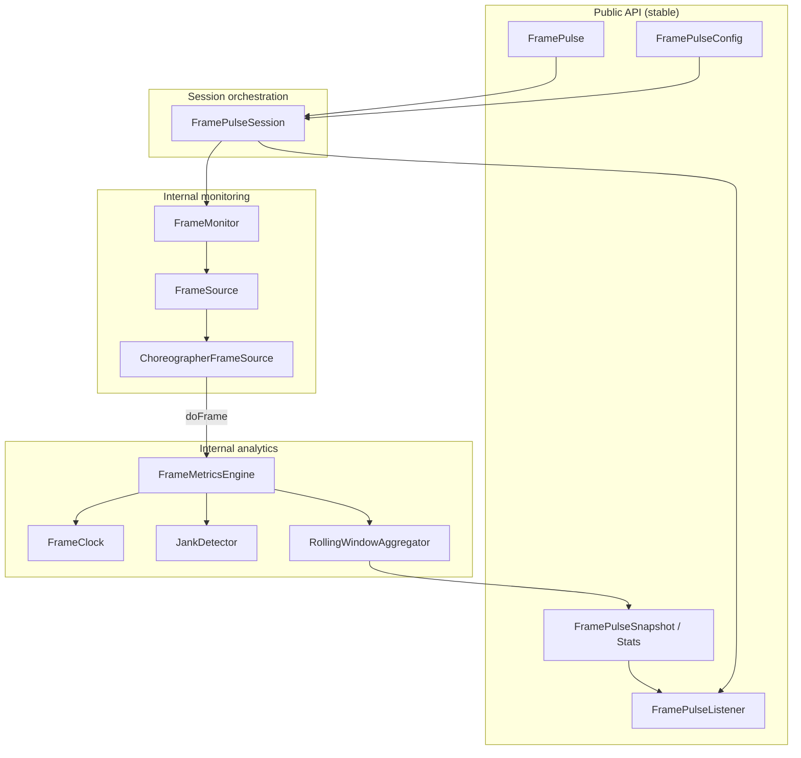

# FramePulse — Architecture & Design Review

> **Status:** Design document (v0.1)  
> **Scope:** Architecture and engineering design only — no implementation code.

This document is aligned with the current project setup: Android library module `framepulse`, namespace `com.mayank.framepulse`, minSdk 21, Kotlin-only core, no Compose in the library, and a separate `:app` demo module.

---

## Table of contents

1. [Library vision validation](#1-library-vision-validation)
2. [MVP scope definition](#2-mvp-scope-definition-v01)
3. [Core feature boundaries](#3-core-feature-boundaries)
4. [Public API responsibilities](#4-public-api-responsibilities)
5. [Internal architecture design](#5-internal-architecture-design)
6. [Package structure proposal](#6-package-structure-proposal)
7. [Core component design](#7-core-component-design)
8. [Choreographer integration strategy](#8-choreographer-integration-strategy)
9. [FPS calculation strategy](#9-fps-calculation-strategy)
10. [Threading model](#10-threading-model)
11. [Data model design](#11-data-model-design)
12. [Testing strategy](#12-testing-strategy)
13. [Benchmarking strategy](#13-benchmarking-strategy)
14. [Risks and tradeoffs](#14-risks-and-tradeoffs)
15. [Future extensibility roadmap](#15-future-extensibility-roadmap)
16. [Architecture questions (FAQ)](#architecture-questions--direct-answers)
17. [Deliverables](#deliverables)
    - [A. High-level architecture diagram](#a-high-level-architecture-diagram)
    - [B. Package structure](#b-package-structure)
    - [C. Component responsibility matrix](#c-component-responsibility-matrix)
    - [D. Public API proposal](#d-public-api-proposal-v01)
    - [E. Recommended architecture for v0.1](#e-recommended-architecture-for-framepulse-v01)
18. [Learning map](#learning-map)
19. [Suggested next steps](#suggested-next-steps)

---

## 1. Library vision validation

**Verdict: Strong and teachable, with a clear positioning wedge.**

| Aspect | Assessment |
|--------|------------|
| Problem | Developers need lightweight, in-app visibility into frame pacing without full Systrace/Perfetto workflows. |
| Mechanism | `Choreographer` is the correct hook for “did the UI thread complete work before the next VSYNC deadline?” on API 21+. |
| Differentiation | Competes conceptually with `FrameMetricsAggregator` (API 24+), Jetpack JankStats (Compose), and APM SDKs. Wedge: **small, explicit, educational, Choreographer-first, View-system friendly**. |
| Learning goal | Forces you through Looper → MessageQueue → Choreographer → frame callbacks → VSYNC semantics — excellent for internals depth. |

### Why this vision works

- Jank is fundamentally a **deadline miss** on the UI thread relative to display refresh, not “low average FPS” alone.
- Choreographer sits at the scheduling boundary where that deadline is visible.

### Alternative approaches

| Approach | When it wins | Production implication |
|----------|--------------|-------------------------|
| Systrace / Perfetto | Deep system traces | Not embeddable; dev-time only |
| `FrameMetrics` / aggregator | Per-window, layout/draw breakdown | Heavier API surface; API 24+ for rich data |
| APM (Firebase, etc.) | Fleet-wide | Opaque, heavy, not for learning OSS |
| GPU/overdraw tools | Rendering cost | Different layer than frame pacing |

### Scalability implications

- Vision scales to v1+ (histograms, session export, debug overlay module) if v0.1 keeps a **narrow, correct core metric pipeline**.

---

## 2. MVP scope definition (v0.1)

### In scope

- Start/stop monitoring tied to a `Looper` (default: main).
- Per-frame timestamps via `Choreographer.FrameCallback`.
- Rolling FPS over a configurable window (e.g. 1s).
- Jank detection via frame interval vs refresh period (heuristic, documented).
- Listener/callback API delivering immutable snapshots.
- Single active session per monitor instance (documented).
- README: concepts (VSYNC, Choreographer, jank definition used by the library).
- Sample `:app` demo (Views; Compose stays in app only).

### Explicitly out of scope for v0.1

- Compose integration module.
- Layout/measure/draw attribution (`FrameMetrics` breakdown).
- Automatic activity/window attachment.
- Persistence, networking, dashboards.
- Multi-process.
- Systrace injection / `atrace`.
- Production APM-style sampling and PII.

### Why

- MVP should prove **correctness + low overhead + stable API**, not feature breadth.
- Attribution and window wiring multiply lifecycle and API complexity.

---

## 3. Core feature boundaries



**Boundary rule:** Public layer configures and subscribes; internal layer owns Choreographer, math, and threading.

---

## 4. Public API responsibilities

| Type | Responsibility |
|------|----------------|
| Entry / session | Lifecycle: start, stop, isRunning; idempotent rules documented |
| Config | Window duration, jank threshold multiplier, listener dispatch thread policy |
| Listener | Push model: periodic or per-frame snapshots (pick one primary for v0.1) |
| Snapshot / metrics DTOs | Immutable, documented fields, no mutable builders exposed |
| Errors | Typed failures: wrong thread, already started, monitor disposed |

**Public API must not expose:** `Choreographer`, raw nanosecond arrays, internal aggregators, or test doubles.

---

## 5. Internal architecture design

**Recommended pattern: Facade + Session + Pipeline**



### Layers

1. **Frame source** — Registers/unregisters frame callbacks on a `Looper`.
2. **Frame clock** — Converts nanos to intervals; resolves expected frame period (60/90/120 Hz).
3. **Metrics engine** — FPS + jank classification from intervals.
4. **Aggregator** — Rolling window, min/max/percentiles later.
5. **Session** — Orchestrates lifecycle and listener dispatch.

---

## 6. Package structure proposal

```
com.mayank.framepulse
├── FramePulse.kt                 // facade / factory
├── FramePulseConfig.kt
├── FramePulseListener.kt
├── FramePulseSession.kt          // optional: session handle if not folded into facade
├── model/
│   ├── FramePulseSnapshot.kt
│   ├── FrameStats.kt
│   └── JankStats.kt
└── (no internal types here)

com.mayank.framepulse.internal
├── monitor/
│   ├── FrameMonitor.kt
│   └── FrameMonitorImpl.kt
├── source/
│   ├── FrameSource.kt
│   └── ChoreographerFrameSource.kt
├── engine/
│   ├── FrameMetricsEngine.kt
│   └── JankDetector.kt
├── clock/
│   └── FrameClock.kt
├── aggregate/
│   └── RollingWindowAggregator.kt
└── util/
    └── MainThread.kt
```

### Why

- Single public root package = easy discovery and ProGuard/R8 story.
- `internal` Kotlin visibility + `consumer-rules.pro` keeps implementation off the ABI consumers rely on.

### Alternative

Multi-module (`:framepulse-core`, `:framepulse-compose`) early — **defer** until v0.1 API is stable.

---

## 7. Core component design

See [Component responsibility matrix](#c-component-responsibility-matrix) for the full table.

---

## 8. Choreographer integration strategy

### Should FramePulse talk directly to Choreographer?

| Layer | Talks to Choreographer? |
|-------|-------------------------|
| Public API | **Never** |
| `ChoreographerFrameSource` | **Yes** |
| Tests | Fake `FrameSource` injecting timestamps |

### Integration rules (v0.1)

1. All registration on the target `Looper` thread (main by default).
2. **One** recurring `FrameCallback` chain per active session (avoid duplicate posts).
3. Use `frameTimeNanos` from `doFrame` — VSYNC-aligned, comparable across frames.
4. On `stop()`, remove callbacks and clear state to prevent leaks and ghost metrics.
5. Document observer effect: your callback runs on the UI thread; keep work O(1).

### Alternative approaches

| Strategy | Pros | Cons |
|----------|------|------|
| Direct Choreographer | API 16+, full control, educational | You own refresh-rate edge cases |
| `FrameMetrics` listener | Rich stages | API 24+, heavier, splits your story |
| `Choreographer.getInstance()` static | Simple | Harder to test; inject via `FrameSource` factory instead |

### Production implications

- Wrong-thread registration → crashes or silent wrong metrics; enforce at API boundary.
- Missing `stop()` on destroy → battery + misleading FPS; session must be explicit or documented with lifecycle helpers in **app**, not magic in core v0.1.

### Scalability implications

- `FrameSource` allows optional `FrameMetricsFrameSource` in v0.2 without breaking listeners.

---

## 9. FPS calculation strategy

### Definition for v0.1 (document clearly in README/KDoc)

- **Instantaneous FPS:** `1000 / Δt_ms` from consecutive `frameTimeNanos` (clamp outliers).
- **Window FPS:** `(N - 1) / windowDuration` over rolling window, where N = frames in window.

### Refresh rate

- Default expected frame period: **16.67ms (60Hz)**.
- v0.1: constant or simple `Display.getRefreshRate()` when context is supplied optionally — **do not require Context in core** for v0.1; document 60Hz assumption or add optional `refreshHz` in config.

### Jank heuristic (v0.1)

- Jank frame if `Δt > framePeriod × jankMultiplier` (default multiplier **1.5** or **2.0** — pick one, document, make configurable).
- Track: `jankCount`, `maxFrameTimeMs`, `p95` later.

### Why not only average FPS

- 58 FPS with periodic 200ms hitches is bad UX; jank counts matter.

### Alternative approaches

| Method | Tradeoff |
|--------|----------|
| Fixed 16.67ms budget | Simple; wrong on 90/120Hz devices |
| Dynamic refresh rate | Accurate; needs Display/Context or API callbacks |
| Cumulative Choreographer skipped frames | Not directly exposed on public API |

### Production implications

- Mis-calibrated jank on high-refresh devices → false positives; roadmap item for dynamic Hz.
- Outlier spikes (GC pause) → consider cap or separate “severe jank” tier in v0.2.

---

## 10. Threading model



### v0.1 recommendation

- Register and run **all frame processing on the UI Looper**.
- Invoke listeners on **main** by default (safest for UI-bound consumers).
- Optional `ListenerExecutor` in config later — not required for v0.1.

### Why

- Choreographer is main-thread-bound; cross-thread posting every frame adds overhead and ordering bugs.

### Alternative

- Offload aggregation only — saves little if aggregation is O(1); adds synchronization complexity.

### Production implications

- Listener doing heavy work → **you** become jank; document “keep listener cheap.”

---

## 11. Data model design

### Public DTOs (immutable)

```
FramePulseSnapshot
├── timestampMillis (wall or elapsed, pick one and stick)
├── fps: Double
├── frameCountInWindow: Int
├── jankCountInWindow: Int
├── averageFrameTimeMs: Double
├── maxFrameTimeMs: Double
└── (optional) lastFrameTimeMs: Double
```

### Internal

- Ring buffer of longs (frame times or deltas) — fixed capacity from config.
- No unbounded lists in production path.

### Why immutable snapshots

- Thread-safe handoff to listeners; stable for logging and tests.

### Alternative

- Streaming API (`Flow`) — nice for v0.2; callback/listener is simpler for v0.1 and minSdk 21.

---

## 12. Testing strategy

| Layer | Approach |
|-------|----------|
| Unit (JVM) | `FakeFrameSource` + inject timestamps; test engine, jank detector, aggregator math |
| Android instrumented | Run monitor on main thread; Espresso idle + controlled Choreographer (limited) |
| Robolectric (optional) | Main looper simulation; adds dependency — evaluate after pure JVM tests |
| Contract | Golden snapshots for known frame sequences (60fps steady, one spike, sustained jank) |

### What to test first

1. FPS over perfect 16.67ms intervals ≈ 60.
2. Single 50ms gap → jank count +1.
3. start/stop does not double-register.
4. stop → no further listener calls.

### Why

- Choreographer is hard to unit test directly; **`FrameSource` abstraction is your testability hinge**.

---

## 13. Benchmarking strategy

**Goals:** Prove library overhead ≪ 1ms per frame on mid device.

| Tool | Use |
|------|-----|
| Macrobenchmark module (later) | Compare app with/without FramePulse |
| Android Studio Profiler (CPU) | UI thread method cost while scrolling |
| Systrace tag (internal debug flag) | Optional `Trace.beginSection` in debug builds only |

### Metrics to publish in README

- Per-frame callback duration (p50/p95).
- Memory: ring buffer size × sessions.

### Baseline

- Same demo `:app` scrolling RecyclerView with monitor on vs off.

### Production implications

- Shipping debug tracing in release → unacceptable; use `BuildConfig.DEBUG` or internal flag.

---

## 14. Risks and tradeoffs

| Risk | Mitigation |
|------|------------|
| Observer effect (your callback adds jank) | O(1) work; no allocations in hot path; object pooling only if profiling proves need |
| 90/120Hz false jank | Document; config `expectedFramePeriodMs` / refresh rate in v0.1.1 |
| Background monitoring | Document “monitor when UI visible”; pause API in v0.2 |
| API churn | Small v0.1 surface; `@ExperimentalFramePulse` for unstable bits |
| Competing with platform metrics | Position as learning + lightweight control, not APM replacement |
| `internal` visibility leaks | Consumer ProGuard rules + binary compatibility discipline |
| GitHub credibility | Excellent README diagrams linking to your learning narrative |

---

## 15. Future extensibility roadmap

| Version | Features |
|---------|----------|
| v0.1 | Choreographer pipeline, FPS + jank, listener, demo app |
| v0.2 | `FrameMetrics` source, per-stage hints (API 24+) |
| v0.3 | `framepulse-compose` optional module |
| v0.4 | Debug overlay module (separate artifact) |
| v0.5 | Session export (JSON), percentile stats |
| v1.0 | Stable API, semver, published Maven Central |

---

## Architecture questions — direct answers

### 1. Should FramePulse directly talk to Choreographer?

**Public API: no. Internal `ChoreographerFrameSource`: yes.**

### 2. Should there be a FrameMonitor abstraction?

**Yes.** `FrameMonitor` + `FrameSource` separates lifecycle from acquisition. Staff-level choice for tests and v0.2 sources.

### 3. What should remain public API?

`FramePulse` (or factory), `FramePulseConfig`, `FramePulseListener`, `FramePulseSession` (if split), and `model.*` snapshots/stats only.

### 4. What should remain internal?

Everything touching Choreographer, aggregation buffers, jank math, threading helpers, and fake/test adapters (test via `testFixtures` or `src/test` only).

### 5. How should responsibilities be separated?

**Source → Engine → Aggregate → Session → Listener.** No layer skips; public facade only talks to Session/Monitor.

### 6. What would a Staff Android Engineer choose?

- **Thin stable public surface**
- **Choreographer behind interface**
- **Main-thread hot path, O(1), allocation-free**
- **Explicit lifecycle** (no reflection-based auto-hook in v0.1)
- **Honest documentation** of jank definition and 60Hz assumptions
- **Demo app as proof**, not slides
- **Defer** Compose module, `Flow`, and `FrameMetrics` until core math is proven in tests

---

## Deliverables

### A. High-level architecture diagram



---

### B. Package structure

See [Section 6](#6-package-structure-proposal).

---

### C. Component responsibility matrix

| Component | Owns | Must not own |
|-----------|------|--------------|
| `FramePulse` (facade) | Global start/stop ergonomics, thread checks | Frame math |
| `FramePulseSession` | Listener wiring, stop cleanup | Choreographer registration details |
| `FramePulseConfig` | Window size, jank threshold, dispatch policy | Runtime state |
| `FrameMonitor` | Callback chain lifecycle on one Looper | Public listener types |
| `ChoreographerFrameSource` | `postFrameCallback` / removal | FPS formulas |
| `FrameClock` | Monotonic deltas, expected frame period | Aggregation windows |
| `JankDetector` | Interval vs budget classification | Publishing snapshots |
| `RollingWindowAggregator` | Windowed FPS, counts | VSYNC registration |
| `FramePulseSnapshot` | Immutable report | Behavior |

---

### D. Public API proposal (v0.1)

Conceptual surface only — not implementation code.

```kotlin
// Entry
object FramePulse {
    fun start(config: FramePulseConfig = FramePulseConfig.DEFAULT): FramePulseSession
}

// Session handle
interface FramePulseSession {
    fun stop()
    val isRunning: Boolean
}

// Configuration
data class FramePulseConfig(
    val windowDurationMs: Long = 1000L,
    val jankThresholdMultiplier: Float = 1.5f,
    val expectedFramePeriodMs: Float = 16.67f, // document refresh rate assumption
    val looper: Looper? = null // null => main
)

// Callback
fun interface FramePulseListener {
    fun onSnapshot(snapshot: FramePulseSnapshot)
}

// Snapshot
data class FramePulseSnapshot(
    val elapsedRealtimeMs: Long,
    val fps: Double,
    val frameCount: Int,
    val jankCount: Int,
    val averageFrameTimeMs: Double,
    val maxFrameTimeMs: Double,
)
```

**Dispatch model for v0.1:** listener fired every frame **or** every N ms — **recommend every frame with throttled snapshot (e.g. max 1 listener call per 100ms)** to balance accuracy vs overhead. Document the choice.

---

### E. Recommended architecture for FramePulse v0.1

| Decision | Choice |
|----------|--------|
| Frame signal | `ChoreographerFrameSource` behind `FrameSource` |
| Abstraction | `FrameMonitor` owns callback chain |
| Math | `FrameMetricsEngine` + `JankDetector` + `RollingWindowAggregator` |
| API | Facade + `FramePulseSession` + listener + immutable snapshot |
| Threading | Main looper only in v0.1 |
| Context | Not required in core v0.1 |
| Modules | Single `:framepulse` library; `:app` for demo |
| Dependencies | Keep core minimal; consider removing `core-ktx` from library if unused |
| Publishing | API 21, `internal` for impl, consumer ProGuard rules |

---

## Learning map

| Concept | Where you learn it in FramePulse |
|---------|----------------------------------|
| Looper / MessageQueue | Why callbacks must run on main |
| Choreographer | `FrameSource` integration |
| VSYNC | Meaning of `frameTimeNanos` |
| Jank | Interval vs frame budget in `JankDetector` |
| SurfaceFlinger | README / docs (not hooked in v0.1 — compositor is below your hook) |
| Library architecture | Public/internal split, semver, testing fakes |

**Note:** SurfaceFlinger is **below** Choreographer in the stack; v0.1 correctly measures **UI-thread readiness for the next frame**, not GPU composition latency. Document this clearly — it signals senior understanding.

---

## Suggested next steps

1. Lock v0.1 API names and listener throttle policy.
2. Add `FrameSource` + engine unit tests with fake timestamps **before** Choreographer wiring.
3. Wire `ChoreographerFrameSource` and validate in `:app` with a scrolling list.
4. Write README section: “What FramePulse measures vs what it does not.”

---

## Technical constraints (reference)

- Kotlin only
- Android Library module
- Min SDK 21
- No dependency injection framework
- No Compose dependency in core module
- Keep architecture simple
- Avoid overengineering
- API stability is important
- Performance overhead must be minimal
- Public APIs should be carefully designed
- Internal implementation should remain hidden

---

## Project goals (reference)

1. Learn Android internals deeply
2. Learn library architecture
3. Learn performance engineering
4. Build production-grade OSS library
5. Create recruiter-impressive GitHub project
6. Understand rendering pipeline, VSYNC, Choreographer, Looper, MessageQueue, SurfaceFlinger and jank analysis
