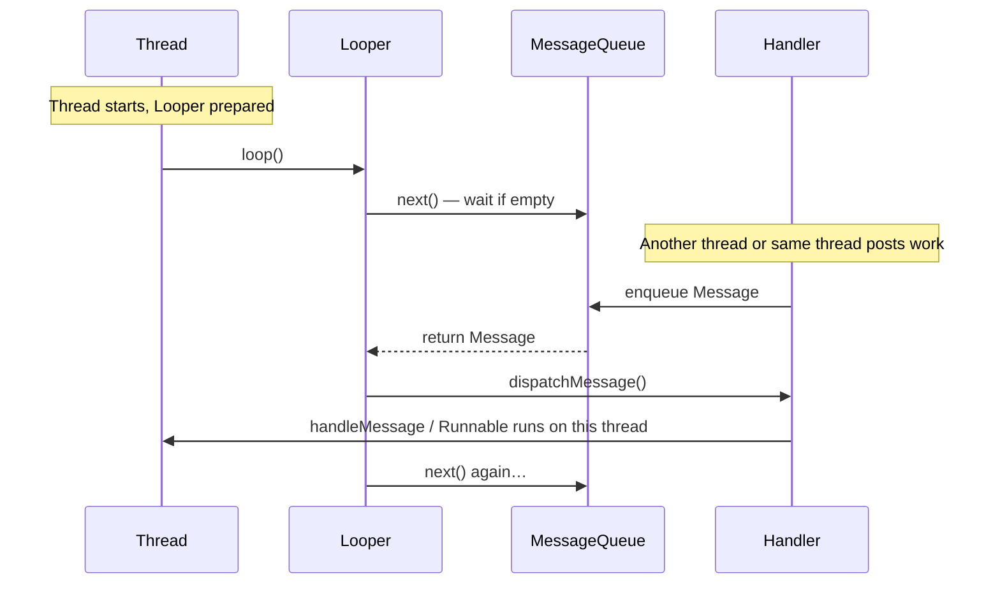
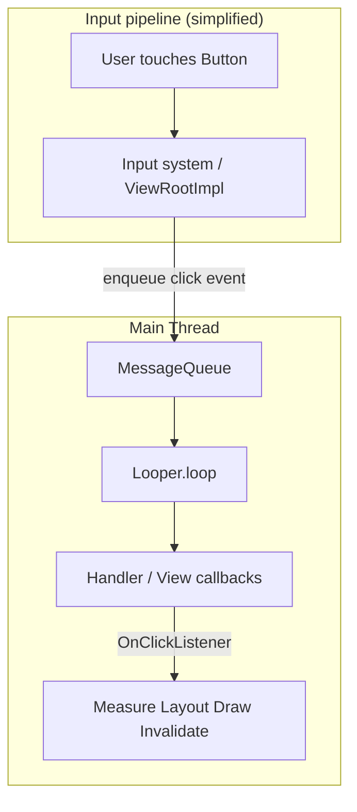

# Android Internals: Thread, Looper, MessageQueue, Handler

A first-principles guide for Android engineers. This document explains **how the UI thread processes work** — without Choreographer or performance tooling.

---

## Table of contents

1. [What is a Thread?](#1-what-is-a-thread)
2. [What is the Main Thread?](#2-what-is-the-main-thread)
3. [What is a Looper?](#3-what-is-a-looper)
4. [What problem does Looper solve?](#4-what-problem-does-looper-solve)
5. [What is a MessageQueue?](#5-what-is-a-messagequeue)
6. [What is a Message?](#6-what-is-a-message)
7. [What is a Handler?](#7-what-is-a-handler)
8. [How they relate](#8-relationship-thread-looper-messagequeue-handler)
9. [Complete flow: button click to UI update](#9-complete-flow-button-click--ui-update)
10. [Quick reference](#10-quick-reference)

---

## 1. What is a Thread?

### First principles

A **thread** is a single path of execution inside your app process. Your app’s code runs on one or more threads. Each thread has its own call stack (which function called which).

Think of a process as a **building**, and threads as **workers** inside it. One worker can only do one task at a time at their desk — but you can have many workers (threads) in the same building (process).

```
Process (your app)
├── Thread A  →  runs code path 1
├── Thread B  →  runs code path 2
└── Thread C  →  runs code path 3
```

### Key ideas

| Idea | Meaning |
|------|---------|
| **Concurrent** | Multiple threads can be *in progress* over time (not always literally at the same CPU instant, but overlapping). |
| **Parallel** | Multiple threads actually run at the same time on multiple CPU cores. |
| **Main vs background** | Android cares *which* thread touches UI — more on that in the next section. |

### Real-world analogy

A **restaurant kitchen**:

- One chef (one thread) can chop onions **or** plate food at a given moment — not both in the same hand at the same instant.
- If you hire more chefs (more threads), more dishes can move forward — but they must coordinate (shared fridge = shared memory).

### Android example

```kotlin
// Runs on whatever thread calls this
fun fetchUser() {
    Thread {
        val user = api.getUser()  // background thread
        runOnUiThread {
            textView.text = user.name  // must hop to main for UI
        }
    }.start()
}
```

`Thread { }` creates a **new** worker. UI widgets (`TextView`) are **not** safe to update from that new thread by default.

---

## 2. What is the Main Thread?

### First principles

The **main thread** (also called the **UI thread**) is the thread Android creates when your app starts. It is where:

- Activity / Fragment lifecycle callbacks run (`onCreate`, `onResume`, …)
- Touch events are dispatched
- `View` measure, layout, and draw are triggered
- Most SDK callbacks you “just use” arrive

There is **one** main thread per app process (for standard apps).

### Why it exists

The window system and `View` hierarchy were designed with a rule:

> **Only the main thread should mutate the UI tree.**

If two threads changed the same `TextView` at once, you could get torn state, crashes, or subtle bugs. So Android centralizes UI work on one thread.

### Real-world analogy

A **store with one cashier counter** for customer-facing changes:

- Customers (events) line up at **one** counter (main thread).
- Back room staff (background threads) can prepare boxes, but they **hand a ticket** to the cashier to change what’s on the display.

### Android example

```kotlin
override fun onCreate(savedInstanceState: Bundle?) {
    super.onCreate(savedInstanceState)
    // You are on the main thread here
    binding.title.text = "Hello"
}

button.setOnClickListener {
    // Still main thread
    binding.counter.text = "Clicked"
}
```

If you call `binding.title.text = "Oops"` from a raw `Thread`, you may get:

`CalledFromWrongThreadException: Only the original thread that created a view hierarchy can touch its views.`

---

## 3. What is a Looper?

### First principles

A **Looper** is an object that runs on a thread and **loops forever**, waiting for work, taking work, executing work, repeat — until the thread exits.

Pseudo-logic:

```
prepare Looper for this thread
while (thread is alive) {
    nextWork = MessageQueue.next()   // may block until work exists
    dispatch nextWork to Handler
}
```

So the thread is **not** “finished” after `onCreate()` returns. It enters a **event loop** and stays alive to service future messages (clicks, animations, lifecycle, etc.).

### Real-world analogy

A **receptionist at a desk** who never leaves:

1. Checks the inbox (queue).
2. If empty, waits.
3. Picks the next slip (message).
4. Hands it to the right department (handler).
5. Goes back to step 1.

The receptionist **is** the Looper loop on that thread.

### Android example

Main thread Looper is set up before your `Application` / first Activity runs. You rarely call this on the main thread yourself:

```kotlin
// Pattern for a BACKGROUND thread only — not how main thread is born
Thread {
    Looper.prepare()        // attach a Looper to *this* thread
    val handler = Handler(Looper.myLooper()!!)
    handler.post { /* work on this background thread */ }
    Looper.loop()           // blocks; processes queue until quit
}.start()
```

On the main thread, the system already did `prepare()` + `loop()` for you.

---

## 4. What problem does Looper solve?

### The problem

Without a Looper, a thread would:

1. Run `onCreate()`
2. Reach the end of the method
3. **Exit** — and never process the button click that arrives 2 seconds later

UI apps are **event-driven**: work arrives unpredictably (tap, network callback, alarm). Something must **hold the thread open** and **schedule** work fairly over time.

### What Looper provides

| Problem | Looper’s answer |
|---------|-----------------|
| Thread exits too early | `loop()` keeps thread alive |
| Many events, one thread | Serialize work through a queue |
| “Run this later on thread X” | Post a `Message` / `Runnable` to that thread’s queue |
| “Run this in 300ms” | Delayed messages with `postDelayed` |

### Real-world analogy

Without a receptionist (Looper), employees go home after one task. The phone rings — nobody answers.

With a Looper, the desk stays staffed; requests pile up in order (mostly FIFO) and get handled one by one.

### Android example

```kotlin
handler.postDelayed({
    showSnackbar("Saved")
}, 300)
```

The main thread might be busy drawing a frame or handling a scroll. The snackbar task **waits in the queue** until the Looper dispatches it.

---

## 5. What is a MessageQueue?

### First principles

A **MessageQueue** is a **queue data structure** tied to one Looper. Producers **enqueue** messages; the Looper **dequeues** and dispatches them.

Important properties:

- **FIFO** by default (first in, first out) for messages with the same timing.
- **Blocking**: `next()` can wait when the queue is empty (thread sleeps efficiently instead of spinning CPU).
- **Time ordering**: Messages can be scheduled for the future (`when` uptime), so the queue is often implemented as a **priority queue by time**, not a naive FIFO for everything.

```
  post A ──┐
  post B ──┼──►  [ MessageQueue ]  ──► Looper takes head ──► Handler
  post C ──┘
```

### Real-world analogy

A **ticket dispenser at the deli counter**:

- Customers take numbers (messages).
- The clerk (Looper) calls “Next!” (dequeue).
- Some tickets are “come back in 5 minutes” (delayed messages).

### Android example

When you call:

```kotlin
handler.post { binding.progress.isVisible = false }
```

You are enqueueing a `Runnable` wrapped as a `Message` on the **main thread’s** `MessageQueue`. It runs when earlier messages ahead of it have been processed.

---

## 6. What is a Message?

### First principles

A **Message** is a small **envelope of work** for the Looper system. It typically carries:

| Field (conceptual) | Role |
|--------------------|------|
| **what** | Integer code (e.g. `MSG_SHOW_DIALOG`) |
| **obj** | Optional payload (`String`, `Bundle`, etc.) |
| **target** | Which `Handler` should handle it |
| **callback** | Optional `Runnable` to run directly |
| **when** | When it should run (for scheduling / delay) |

Many APIs use the convenience path: `Handler.post(Runnable)` — internally that still becomes a `Message` with a `callback` set.

### Real-world analogy

A **work order slip**:

- **what** = type of job (“restock”, “clean”, “ring bell”)
- **obj** = details (“aisle 4”, “spill near door”)
- **target** = which team handles it (Handler)

### Android example

Classic pattern (less common in modern Kotlin app code, but still in framework internals):

```kotlin
private const val MSG_LOAD_IMAGE = 1

private val handler = object : Handler(Looper.getMainLooper()) {
    override fun handleMessage(msg: Message) {
        when (msg.what) {
            MSG_LOAD_IMAGE -> {
                val url = msg.obj as String
                imageView.setImageBitmap(load(url))
            }
        }
    }
}

// Somewhere else:
handler.sendMessage(
    Message.obtain(handler, MSG_LOAD_IMAGE, imageUrl)
)
```

Modern style — same queue, simpler API:

```kotlin
handler.post { imageView.setImageBitmap(bitmap) }
```

---

## 7. What is a Handler?

### First principles

A **Handler** is the object you use to **send** messages to a `MessageQueue` and **handle** them when dispatched.

A Handler is always associated with:

- A **Looper** (and therefore a specific **thread**)

Constructor idea:

```kotlin
Handler(Looper.getMainLooper())  // messages run on main thread
```

| Responsibility | Description |
|----------------|-------------|
| **Producer API** | `post`, `postDelayed`, `sendMessage`, `removeCallbacks` |
| **Consumer API** | `handleMessage(msg)` or run embedded `Runnable` |

### Real-world analogy

A **department manager** with an inbox slot at the reception desk:

- Anyone can drop requests addressed to “Manager A” (`Handler`).
- The receptionist (Looper) only delivers to the right manager.
- The manager executes the task (`handleMessage` / `Runnable`).

### Android example

```kotlin
class MainActivity : AppCompatActivity() {

    private val handler = Handler(Looper.getMainLooper())

    override fun onCreate(savedInstanceState: Bundle?) {
        super.onCreate(savedInstanceState)

        lifecycleScope.launch {
            val data = withContext(Dispatchers.IO) { repository.load() }
            // Back on main — but if you were still on IO:
            handler.post {
                binding.list.adapter = MyAdapter(data)
            }
        }
    }
}
```

`Handler(Looper.getMainLooper())` is the explicit “put work on the UI queue” tool. Higher-level APIs (`runOnUiThread`, `view.post`, coroutines `Main`) ultimately lean on the same main `Looper`.

---

## 8. Relationship: Thread, Looper, MessageQueue, Handler

### One thread, one Looper (usually)

```
┌─────────────────────────────────────────────────────────────┐
│  Thread (e.g. Main / UI Thread)                             │
│                                                             │
│   ┌──────────┐      owns      ┌─────────────────┐         │
│   │  Looper  │ ──────────────► │  MessageQueue   │         │
│   └──────────┘                 └────────▲────────┘         │
│        │                                 │ enqueue          │
│        │ loop: dequeue & dispatch        │                  │
│        ▼                                 │                  │
│   ┌──────────┐  target                  │                  │
│   │ Handler  │ ─────────────────────────┘                  │
│   │ Handler  │  (many handlers can share one Looper)        │
│   └──────────┘                                              │
└─────────────────────────────────────────────────────────────┘
```

### Rules of thumb

| Rule | Explanation |
|------|-------------|
| **1 thread : 0 or 1 Looper** | A thread without `Looper.prepare()` has no Looper. Main thread gets one automatically. |
| **1 Looper : 1 MessageQueue** | Created together when Looper is prepared. |
| **Many Handlers : 1 Looper** | All handlers on main share the **same** queue and thread. |
| **Handler → Looper → Thread** | `Handler.looper` tells you which thread will run the callback. |

### How they cooperate (timeline)



### Android examples mapping to the stack

| API you use | What it really does |
|-------------|---------------------|
| `view.post { }` | Enqueue on **view’s** handler (attached to UI thread Looper) |
| `runOnUiThread { }` | Activity’s main Handler posts to main queue |
| `Handler(Looper.getMainLooper()).post { }` | Explicit main queue |
| `lifecycleScope.launch { }` (main) | Coroutine scheduler posts continuations to main dispatcher → main Looper |

---

## 9. Complete flow: button click → UI update

This section traces a tap from input to visible UI change using only Thread / Looper / MessageQueue / Handler concepts.

### Big picture diagram



### Step-by-step (what actually happens)

#### Step 0 — App is already running

The main thread is inside `Looper.loop()`, blocked or busy processing earlier messages. The UI is on screen.

```
Main thread:  … → Looper → MessageQueue → (waiting or handling messages)
```

#### Step 1 — Button click (hardware → framework)

Your finger touches the screen. The system’s input pipeline eventually determines: “this touch hit `Button` at (x,y).”

That result is **not** magically calling your lambda immediately on a random thread. It is turned into **work** scheduled on the **main thread’s MessageQueue** (via framework internal handlers — still the same Looper model).

**Analogy:** Customer presses the doorbell → security writes a ticket → puts it in the front desk inbox.

#### Step 2 — Message enters MessageQueue

A message representing the input event (or a related traversal/dispatch step) is **enqueued**. If the main thread is mid-scroll animation, your click message **waits its turn** behind earlier messages.

```
MessageQueue:  [ ... older messages ... ] [ CLICK dispatch ] [ ... ]
```

#### Step 3 — Looper dequeues

`Looper.loop()` calls `MessageQueue.next()`, receives the click-related message, and **dispatches** it to the correct `Handler` / callback target.

**Analogy:** Receptionist pulls the next ticket and calls the right department.

#### Step 4 — Handler / listener runs (your code)

Eventually the dispatch path invokes `View` click handling and your listener:

```kotlin
binding.submit.setOnClickListener {
    binding.status.text = "Submitted"   // UI mutation
    binding.progress.isVisible = true
}
```

This **runs on the main thread** because the Looper dispatched it there.

#### Step 5 — UI update requests more work

Changing `text` or `visibility` marks the view **invalidated** (needs redraw). That schedules **additional** layout/draw messages on the **same** MessageQueue (still main Looper).

So one click often creates a **chain** of messages:

```
CLICK handled
   → invalidate / requestLayout messages
      → performMeasure / performLayout / draw messages
```

#### Step 6 — Looper processes draw messages

Later iterations of `loop()` dequeue layout/draw work. When complete, the frame is ready for the display pipeline (compositor side — outside this doc).

You see the updated label on screen.

### End-to-end ASCII timeline

```
User tap
   │
   ▼
[ Input dispatched as Message on MAIN MessageQueue ]
   │
   ▼
Looper.loop() takes Message
   │
   ▼
Handler / View hierarchy dispatches ACTION_UP
   │
   ▼
Your OnClickListener runs  (main thread)
   │
   ├── binding.status.text = "Submitted"
   └── binding.progress.isVisible = true
           │
           ▼
   [ invalidate / layout / draw Messages enqueued ]
           │
           ▼
Looper processes those Messages
           │
           ▼
Pixels updated on screen
```

### Same flow with a background twist (common interview pattern)

```kotlin
binding.submit.setOnClickListener {
    Thread {
        val result = saveToServer()  // background thread — OK
        handler.post {               // enqueue back to MAIN MessageQueue
            binding.status.text = result
        }
    }.start()
}
```

```
Click (main) → background Thread runs network
                    → handler.post { } enqueues UI work
                         → Looper (main) → updates TextView
```

Without `handler.post`, updating `binding.status` from the background thread violates UI thread rules.

---

## 10. Quick reference

### Glossary

| Term | One-line definition |
|------|---------------------|
| **Thread** | Execution path; main thread owns UI. |
| **Looper** | Runs an infinite loop dispatching queue work on its thread. |
| **MessageQueue** | Incoming mailbox for that Looper. |
| **Message** | Unit of work in the mailbox. |
| **Handler** | Sends to and receives from the queue on a specific Looper. |

### Mental model (one sentence each)

- **Thread** = who runs the code.
- **Looper** = keeps that thread alive and pulls work.
- **MessageQueue** = where work waits in line.
- **Handler** = how you add and process work for that line.

### Check yourself

1. Why can’t the main thread “return from `onCreate` and exit” like a normal `main()` in a console app?  
   → Because `Looper.loop()` must keep running to process future events.

2. Why is `Handler(Looper.getMainLooper())` safe for `TextView` updates?  
   → Because the runnable will execute on the main thread’s Looper.

3. Can two Handlers on the main looper run at the same time?  
   → No — one message dispatch at a time per thread; concurrency is between threads, not within one Looper dispatch.

4. What happens if the main queue is overloaded?  
   → Clicks and UI updates wait longer — “app not responding” (ANR) if one message blocks too long (e.g. network on main thread).

---

## Further reading (Android platform)

- [Processes and threads overview](https://developer.android.com/guide/components/processes-and-threads) — official docs on main thread rules
- AOSP: `android/os/Looper.java`, `MessageQueue.java`, `Handler.java` — source of truth for behavior

---

*Next topic (separate doc): Choreographer and how frame pacing relates to the main Looper.*
