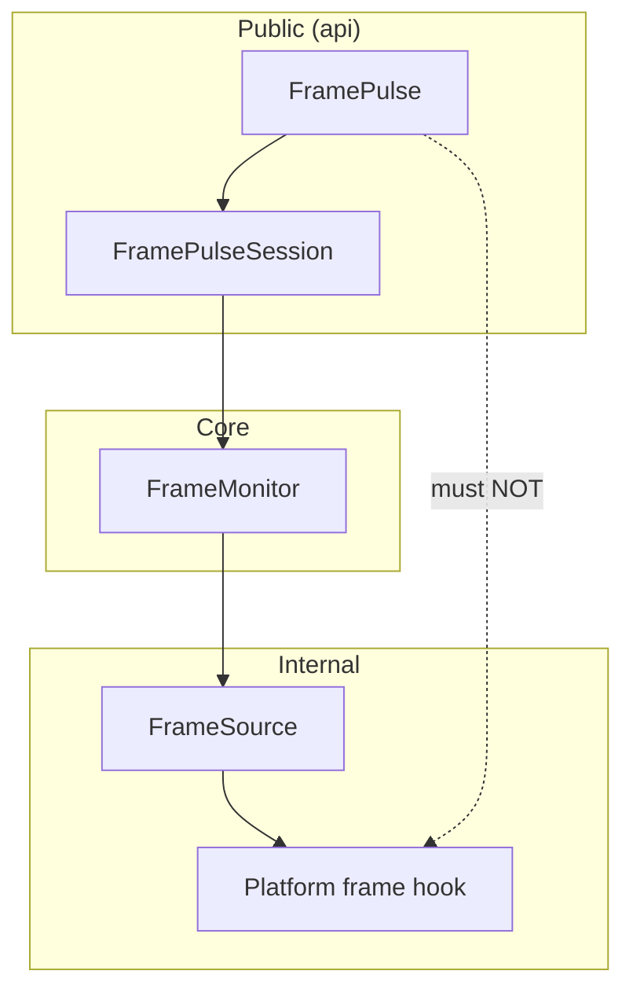
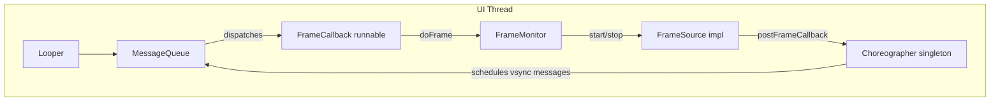
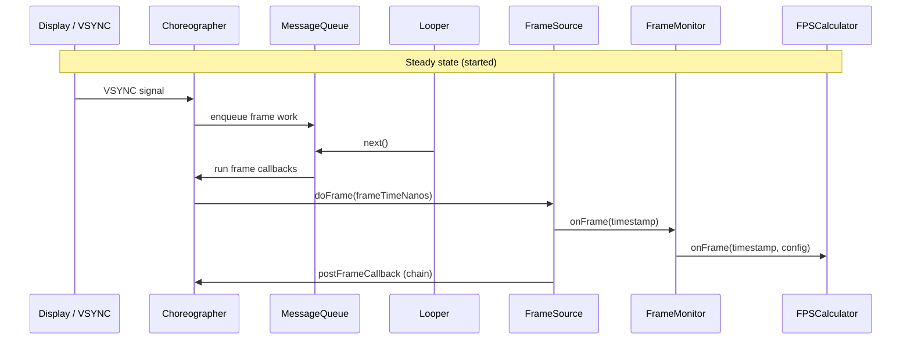
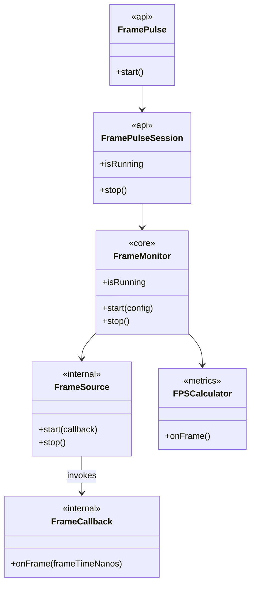
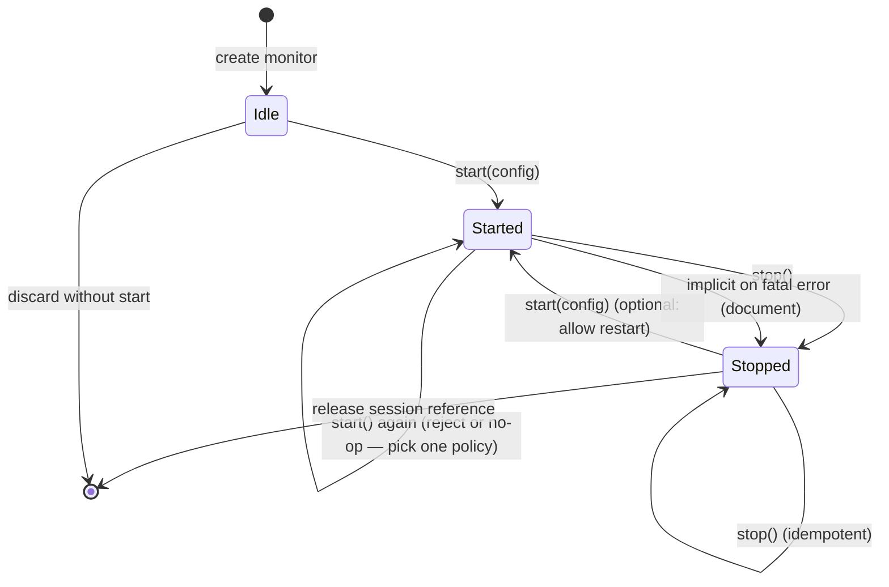
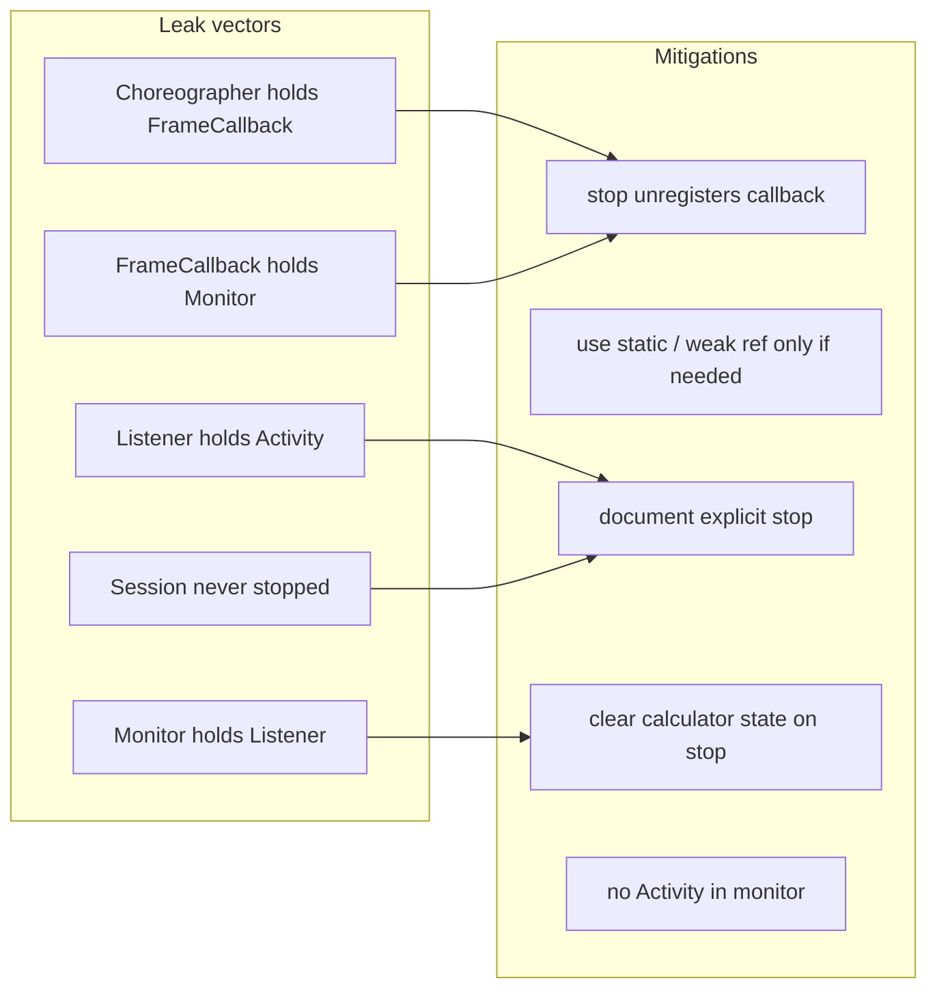
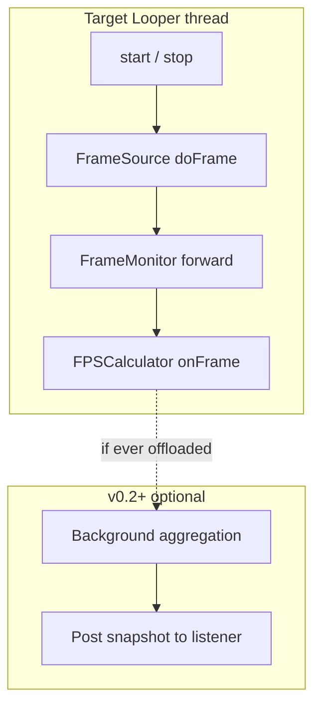
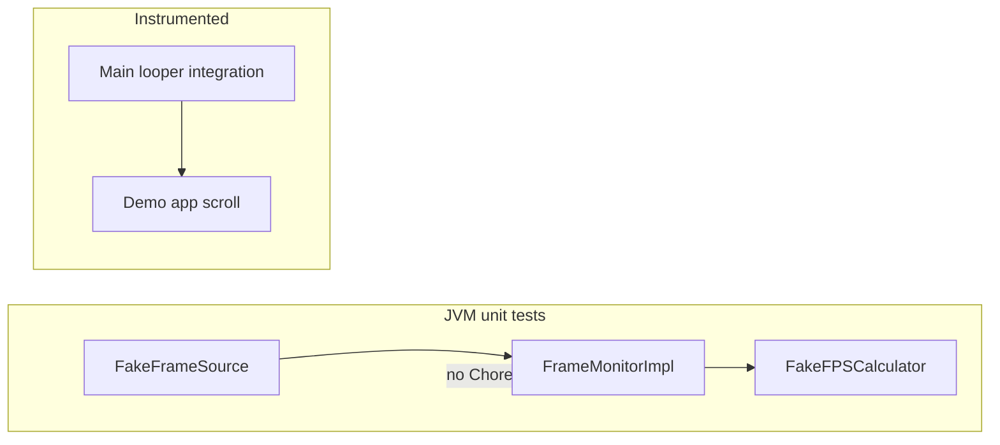
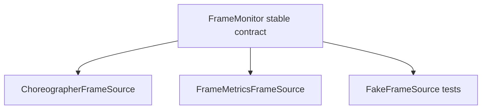
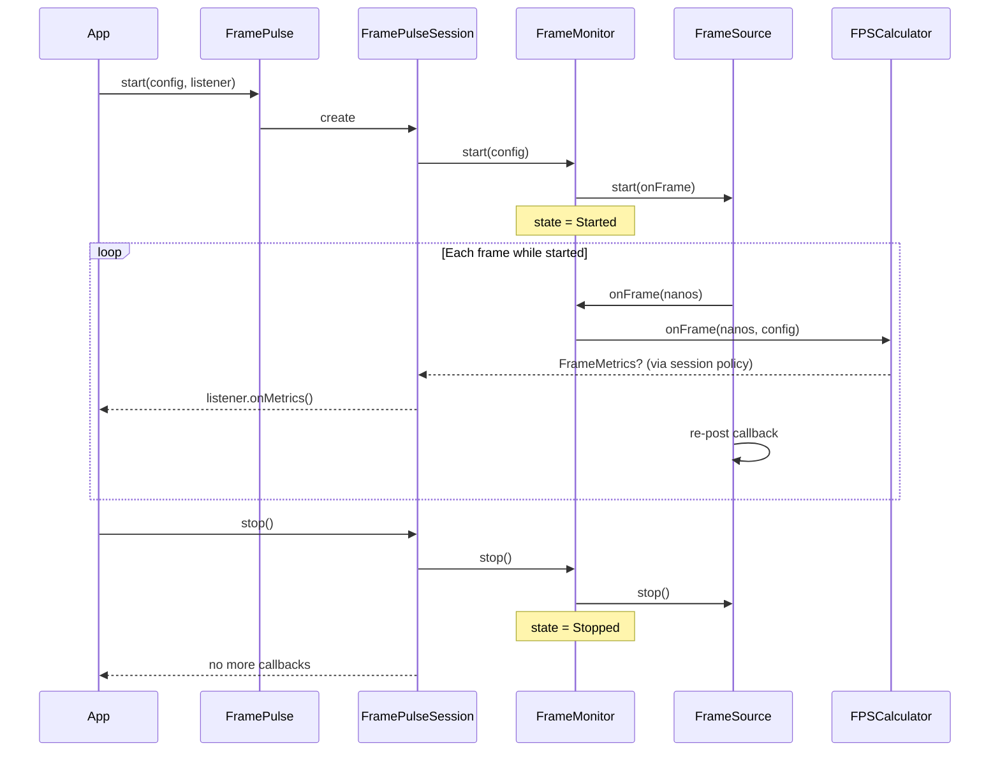

# FrameMonitor — Design Specification

Design-only document for `com.mayank.framepulse.core.FrameMonitor`. Aligns with the approved FramePulse architecture: **orchestration in `core`**, **platform hooks in `internal`**, **math in `metrics`**, **public API in `api`**.

---

## Table of contents

1. [Responsibility of FrameMonitor](#1-responsibility-of-framemonitor)
2. [Why FramePulse should not directly talk to Choreographer](#2-why-framepulse-should-not-directly-talk-to-choreographer)
3. [Relationship: Looper, MessageQueue, Choreographer, FrameMonitor](#3-relationship-looper-messagequeue-choreographer-framemonitor)
4. [Frame lifecycle from VSYNC to callback](#4-frame-lifecycle-from-vsync-to-callback)
5. [Required interfaces and abstractions](#5-required-interfaces-and-abstractions)
6. [State transitions: idle, started, stopped](#6-state-transitions-idle-started-stopped)
7. [Lifecycle and memory leak risks](#7-lifecycle-and-memory-leak-risks)
8. [Threading considerations](#8-threading-considerations)
9. [Testing considerations](#9-testing-considerations)
10. [Future extensibility](#10-future-extensibility)
11. [Responsibility matrix](#responsibility-matrix-framemonitor-ecosystem)
12. [Session + monitor lifecycle](#lifecycle-diagram-session--monitor)
13. [Staff-level summary](#staff-level-summary)

---

## 1. Responsibility of FrameMonitor

`FrameMonitor` is the **session-scoped orchestrator** for frame signal acquisition on exactly one `Looper`. It sits between the public facade/session layer and the metrics pipeline.

### Owns

| Concern | Description |
|---------|-------------|
| **Lifecycle** | Valid transitions among idle → started → stopped; idempotent `stop()` |
| **Registration contract** | At most one active frame-callback chain per monitor instance |
| **Thread affinity** | All start/stop and callback handling occur on the monitor’s target `Looper` |
| **Bridging** | Forward `frameTimeNanos` (and nothing else) to `FPSCalculator` on each frame tick |
| **Teardown** | Unregister callbacks and drop references so the monitor can be GC’d |

### Must not own

| Concern | Delegated to |
|---------|----------------|
| FPS / frame-time math | `FPSCalculator` |
| Immutable public snapshots | `FrameMetrics` + session/listener dispatch |
| Platform registration details | `FrameSource` (internal) |
| Listener callbacks | `FramePulseSession` / facade |
| Jank classification | Future `JankDetector` (metrics/internal) |

### Why a dedicated type (not “just Choreographer”)

FrameMonitor expresses **orchestration policy**: when to attach, when to detach, what to do on each tick, and how to fail safely. The platform hook is a replaceable detail behind `FrameSource`.

---

## 2. Why FramePulse should not directly talk to Choreographer



| Reason | Production implication |
|--------|-------------------------|
| **API stability** | Choreographer is an implementation detail; swapping to `FrameMetrics` or test fakes must not break semver |
| **Testability** | Unit tests inject a fake `FrameSource` with synthetic timestamps — no Robolectric/main looper required for core math |
| **Separation of concerns** | Facade handles “how apps integrate”; monitor handles “how frames are acquired”; source handles “how VSYNC is subscribed” |
| **Observer effect** | Registration mistakes (double post, wrong thread) are isolated and reviewable in one module |
| **Leak surface** | Callback chains held by Choreographer + anonymous runnables are internal; public API stays short-lived session handles |

**Alternative (rejected for v0.1):** `FramePulse` calls `Choreographer.getInstance().postFrameCallback` directly.

- Faster to prototype, but couples published API to main-thread singleton behavior, complicates testing, and encourages lifecycle bugs in consumer code.

**Staff choice:** Choreographer lives behind `FrameSource` in `internal`; `FrameMonitor` depends on `FrameSource`; `FramePulse` depends only on `FrameMonitor` (via session wiring).

---

## 3. Relationship: Looper, MessageQueue, Choreographer, FrameMonitor



| Component | Role relative to FrameMonitor |
|-----------|-------------------------------|
| **Looper** | Thread’s event pump; FrameMonitor is bound to one `Looper` (default: main) |
| **MessageQueue** | FIFO queue of messages/runnables; VSYNC and `Choreographer` work arrive as messages |
| **Choreographer** | Singleton per looper; receives VSYNC signals and invokes `FrameCallback.doFrame(frameTimeNanos)` |
| **FrameMonitor** | Policy layer: start/stop source, receive timestamps, forward to metrics — **does not replace** any of the above |

**Mental model:** VSYNC wakes the display pipeline; the framework posts work to the UI `MessageQueue`; `Choreographer` runs frame callbacks on that thread; `FrameMonitor` is a **guest** on that chain with minimal work per tick.

FrameMonitor is **not** a fourth framework primitive — it is a library-owned coordinator piggybacking on the existing frame callback mechanism.

---

## 4. Frame lifecycle from VSYNC to callback



### Phases (one frame)

1. **VSYNC** — Display hardware signals a new frame boundary (conceptual; actual path is native → SurfaceFlinger → framework).
2. **Schedule** — `Choreographer` receives timing and queues callback work on the UI `MessageQueue`.
3. **Dispatch** — `Looper` dequeues; `Choreographer` invokes registered `FrameCallback`s with `frameTimeNanos` (intended presentation time in nanoseconds).
4. **FrameSource** — Forwards timestamp to FrameMonitor (thin adapter; no math).
5. **FrameMonitor** — Validates state == started; forwards to `FPSCalculator`.
6. **Re-arm** — FrameSource posts the next callback (single chain) while still started.

### What FrameMonitor does *not* see

- GPU composition, buffer latch, or SurfaceFlinger details (below/outside this hook).
- Layout/measure/draw breakdown (future `FrameMetrics` source, not v0.1).

FrameMonitor measures **“a new frame tick arrived on this Looper”**, which proxies UI-thread pacing relative to VSYNC, not full end-to-end rendering cost.

---

## 5. Required interfaces and abstractions



### Recommended contracts

| Abstraction | Package | Purpose |
|-------------|---------|---------|
| **`FrameMonitor`** | `core` | Public-to-module orchestration interface (already sketched) |
| **`FrameMonitorImpl`** | `internal` | Concrete lifecycle + wiring (future) |
| **`FrameSource`** | `internal` | Start/stop platform callback registration |
| **`FrameTickCallback`** (or lambda type) | `internal` | `(frameTimeNanos: Long) -> Unit` invoked on looper thread |
| **`FPSCalculator`** | `metrics` | Pure timestamp → `FrameMetrics?` |
| **`FramePulseSession`** | `api` | Owns monitor + listener throttle + snapshot dispatch |

### Dependency direction (strict)

```
api → core (interface only)
internal → core, metrics, api (config model)
metrics → api (config), model
core → api (config only) — NOT internal types in the interface signature
```

`FrameMonitor`’s public *interface* should not expose `FrameSource` or `Choreographer` types — only `FramePulseConfig` and collaboration via constructor injection inside `internal`.

---

## 6. State transitions: idle, started, stopped



### State semantics

| State | Callbacks registered? | Accepts frames? | Notes |
|-------|----------------------|-----------------|-------|
| **Idle** | No | No | Initial state after construction |
| **Started** | Yes | Yes | Exactly one active chain |
| **Stopped** | No | No | Terminal for that session unless restart explicitly supported |

### Policy recommendations (v0.1)

| Event | Recommended behavior |
|-------|----------------------|
| `start()` from **Started** | Fail fast (`IllegalStateException`) or return early — **prefer fail fast** for debuggability |
| `stop()` from **Idle** | No-op (idempotent) |
| `stop()` from **Stopped** | No-op (idempotent) |
| `start()` after **Stopped** | v0.1: **disallow** — new session via `FramePulse.start()`; avoids stale config/calculator state |

`isRunning` == true **only** in **Started**.

---

## 7. Lifecycle and memory leak risks



| Risk | How it happens | Mitigation |
|------|----------------|------------|
| **Orphaned frame callback** | `stop()` not called; chain keeps posting | Session `stop()` unregisters via `FrameSource`; document lifecycle in README |
| **Monitor → listener → Activity** | Listener captures Activity in lambda | Document: use `applicationContext` or weak ref; monitor must not store listener |
| **Double start** | Two callback chains on same looper | FrameMonitor enforces single chain; second `start()` fails |
| **Calculator buffer growth** | Unbounded history | Ring buffer with fixed capacity in metrics layer; cleared on `stop()` |
| **Static Choreographer callback** | Anonymous inner class lifecycle | Prefer named internal class with explicit `stop()` clearing reference to monitor |
| **Process / background** | Monitoring while invisible | v0.1: host responsibility to `stop()`; v0.2: optional pause API |

**Production rule:** Every `FramePulse.start()` must have a matching `session.stop()` on the same logical UI scope.

FrameMonitor must **never** auto-register from `Application.ActivityLifecycleCallbacks` in v0.1 — magic lifecycle coupling hides leaks and surprises library consumers.

---

## 8. Threading considerations



| Rule | Rationale |
|------|-----------|
| **Register on target looper** | `Choreographer.getInstance(looper)` must match the looper you monitor |
| **Start/stop on same thread** | Avoid races between registration and teardown |
| **Hot path stays on looper** | `onFrame` must be O(1), allocation-free where possible |
| **No blocking in callback** | I/O or locks in monitor/calculator inflate frame times (observer effect) |
| **Listener dispatch (v0.1)** | Prefer **main** if monitor is main — avoids cross-thread ordering bugs |
| **Background dispatch (later)** | Only if aggregation is non-trivial; snapshot handoff must be immutable |

### Thread checks (facade + monitor)

- `FramePulse.start()` may validate “must be called from main” if config omits custom looper — document clearly.
- Custom `Looper` support: all `FrameMonitor` operations for that instance must run on that looper.

---

## 9. Testing considerations



| Layer | What to test | How |
|-------|--------------|-----|
| **FrameMonitor + fake source** | idle → started → stopped, no frames after stop | Inject `FrameSource` that records start/stop and emits synthetic timestamps |
| **Idempotency** | Double `stop()`, `stop()` from idle | Assert source not started |
| **Double start** | Second `start()` throws or is ignored | Assert single `start()` on source |
| **Forwarding** | Timestamp reaches calculator | Fake source emits `N`; verify calculator called `N` times while started |
| **Thread** | Wrong-thread `start()` | Assert documented failure (instrumented or explicit check) |
| **Choreographer** | Not in JVM unit tests | Reserved for small androidTest or manual demo validation |

**Key design enabler:** `FrameSource` interface — FrameMonitor tests never touch Choreographer.

Golden sequences for calculator (separate tests): steady 16.67ms, single spike — monitor tests only verify **forwarding**, not FPS math.

---

## 10. Future extensibility

| Extension | Touch point | FrameMonitor impact |
|-----------|-------------|---------------------|
| **`FrameMetrics` / platform aggregator** | New `FrameSource` impl | Monitor unchanged; select source via config/factory |
| **Pause / resume** | New states or `pause()` | `Started` → `Paused` (callbacks off, state retained) |
| **Multi-looper** | One monitor per looper | Factory `create(looper)` instead of singleton monitor |
| **Jank detection** | `FPSCalculator` + `FrameMetrics` | Monitor still only forwards timestamps |
| **Listener throttle** | Session layer | Monitor unaffected |
| **Debug tracing** | `FrameSource` or monitor impl | `Trace.beginSection` only in debug builds |



---

## Responsibility matrix (FrameMonitor ecosystem)

| Component | Lifecycle | Register callbacks | Receive VSYNC time | FPS math | Listener | Platform types |
|-----------|-----------|-------------------|--------------------|----------|----------|----------------|
| **FramePulse** | Facade start | — | — | — | — | — |
| **FramePulseSession** | stop(), running flag | — | — | — | Dispatch | — |
| **FrameMonitor** | start/stop, state | Via source | Forward | — | — | Hidden |
| **FrameSource** | start/stop chain | Yes | Emit | — | — | Yes (internal) |
| **FPSCalculator** | — | — | Consume | Yes | — | — |
| **FramePulseListener** | — | — | — | — | Consume | — |

---

## Lifecycle diagram (session + monitor)



---

## Staff-level summary

| Question | Answer |
|----------|--------|
| What is FrameMonitor? | Looper-scoped orchestrator for frame ticks — lifecycle + forward timestamps |
| Who talks to Choreographer? | **`FrameSource` in `internal` only** |
| Where does VSYNC matter? | Explains *when* `doFrame` fires; monitor only sees the timestamp |
| v0.1 state machine | **Idle → Started → Stopped**; idempotent `stop()`; avoid restart on same instance |
| Biggest risks | Orphaned callbacks, listener holding Activity, heavy work on UI thread |
| Testing hinge | **`FrameSource` fake** — monitor tests without platform |

This design keeps `core.FrameMonitor` stable and small while allowing platform and metrics evolution without breaking the public API.

---

## Related documentation

- [ARCHITECTURE.md](./ARCHITECTURE.md) — Full library architecture (when present)
